# GameTranslate — Especificação Técnica e Arquitetural (`SPEC.md`)

**Versão:** 1.0.0  
**Plataforma-alvo:** Windows 10 (build 19041 / 2004+) e Windows 11 (x64)  
**Distribuição:** Executável único portátil *self-contained* (`dist\GameTranslate.exe`, ~72,2 MB) — **zero pré-requisitos** de instalação (.NET Runtime, Python, Tesseract ou API keys).

---

## 1. Visão Geral e Objetivo

O **GameTranslate** é uma camada transparente (*overlay*) para Windows que lê legendas e diálogos em inglês diretamente da tela de qualquer jogo em tempo real, traduz para **Português do Brasil (PT-BR)** e renderiza o texto por cima no estilo clássico de **legendas amarelas de cinema/séries** (amarelo `#FFD800` com contorno preto arredondado e sombra suave).

### Requisitos Atendidos
- **Self-contained em `.exe` único:** publicado com `PublishSingleFile=true`, `SelfContained=true`, `IncludeNativeLibrariesForSelfExtract=true` e `EnableCompressionInSingleFile=true`.
- **Zero dependências externas de OCR:** utiliza o motor nativo **`Windows.Media.Ocr.OcrEngine`** embutido no Windows 10/11 (prefere `en-US` se instalado e funciona nativamente mesmo em sistemas que só possuem o pacote `pt-BR`).
- **100% seguro contra Anti-Cheat:** nenhuma injeção de DLL, hook DirectX/Vulkan ou modificação de memória/arquivos do jogo; opera apenas via captura DWM nativa (`BitBlt`) e janela transparente `click-through`.
- **Sobreposição invisível à própria captura (`WDA_EXCLUDEFROMCAPTURE`):** permite posicionar a legenda amarela inclusive sobre a própria área capturada sem que o OCR leia a própria tradução.
- **Baixa latência + alta qualidade linguística:** arquitetura *Fast-First + Refinamento Híbrido* com prévia em ~110 ms e refinamento silencioso sem piscar (*zero-flicker*).

---

## 2. Arquitetura do Sistema

```mermaid
flowchart LR
    A["Captura Nativa<br/>Win32 BitBlt"] --> B["Fingerprint 64x16<br/>Anti-Fundo Escuro"]
    B -- "Diff abaixo do limiar" --> A
    B -- "Mudou" --> C["ImagePreprocessor<br/>Auto / Bloom-Strip / 2x"]
    C --> D["WindowsOcrService<br/>Leitura Espacial + Reparo R->A"]
    D --> E["SubtitlePipeline<br/>Similaridade + Anti-Thrash"]
    E --> F["TranslationService<br/>Glossario 0ms + Cache por Linha"]
    F --> G["Hibrido Paralelo<br/>Google Fast + Bing LLM"]
    G -- "Fast Preview ~110ms" --> H["SubtitleOverlayWindow<br/>OutlinedTextBlock Amarelo"]
    G -- "Refino Sem Piscar" --> H
```



### Stack Tecnológica
- **Linguagem / Framework:** C# / .NET 6 (`net6.0-windows10.0.19041.0`) com WPF (`UseWPF=true`) + WinForms (`UseWindowsForms=true` apenas para `NotifyIcon` na bandeja e `System.Drawing.Bitmap`).
- **DPI Awareness:** `PerMonitorV2` configurado no projeto (`ApplicationHighDpiMode`) com posicionamento de janelas em pixels físicos via Win32 (`MoveWindow`, `GetWindowRect`, `MonitorFromPoint`).
- **Persistência:** arquivo JSON portátil (`GameTranslate.json` ao lado do `.exe`, com fallback automático para `%LocalAppData%\GameTranslate\GameTranslate.json` se a pasta for somente leitura).

---

## 3. Inventário de Arquivos do Repositório

| Caminho | Responsabilidade |
| --- | --- |
| `GameTranslate.csproj` / `GameTranslate.sln` | Configuração de compilação, publish single-file `win-x64`, exclusão de `tests\**` e `InternalsVisibleTo`. |
| `app.manifest` | Compatibilidade Windows 10/11 e execução `asInvoker` (sem exigir admin). |
| `App.xaml` / `App.xaml.cs` | Inicialização, `Mutex` de instância única, tratamento global de exceções e modo `--self-test [--test-image <caminho>]`. |
| `Assets\app.ico` | Ícone multi-resolução (16/32/48/64/256 px) embutido no `.exe`. |
| `Models\AppSettings.cs` | Enums (`OcrFilterMode`, `TranslatorProvider`, `OverlayPositionMode`), `ScreenRect` e modelo completo de configurações. |
| `Native\Win32.cs` | Interop Win32: `BitBlt`, `SetWindowDisplayAffinity` (`WDA_EXCLUDEFROMCAPTURE`), `WS_EX_TRANSPARENT \| WS_EX_NOACTIVATE \| WS_EX_TOOLWINDOW`, `RegisterHotKey`, recorte automático da barra de título (`TrimWindowTitleBarIfOverlapping`), detecção de área cliente por clique (`GetWindowClientRectAtPoint`) e cálculo de rodapé multi-monitor. |
| `Services\SettingsService.cs` | Leitura/escrita portátil do `GameTranslate.json` e inicialização de regiões válidas. |
| `Services\ScreenCaptureService.cs` | Captura via Win32 `BitBlt` + `ComputeFingerprint` 64×16 com supressão de ruído em fundos escuros animados (`luma < 105 → 0`). |
| `Services\ImagePreprocessor.cs` | Ampliação 2x para faixas pequenas, detecção automática de telas escuras com texto claro, inversão suave anti-halo (*bloom-strip*) com supressão de sprites coloridos e padding de borda. |
| `Services\WindowsOcrService.cs` | Conversão direta `Bitmap → SoftwareBitmap` (BGRA8 em memória, < 1 ms), reconstrução espacial em ordem de leitura por `BoundingRect`, junção de letras espaçadas de fontes pixeladas, normalização de `TUDO MAIÚSCULO` e reparo fonotático `R → A`. |
| `Services\TranslationService.cs` | Motor **Híbrido Inteligente** (Google Fast `clients5` + Bing Neural/LLM em paralelo + `dt=qca` sob demanda), Glossário Gamer (0 ms), cache LRU completo e por linha, formatação compacta de menus e provedores opcionais (Google GTX, Reverso, Bing, MyMemory, DeepL API, OpenAI/Ollama local). |
| `Services\SubtitlePipeline.cs` | Loop de captura assíncrono (`140 ms` padrão), filtro de similaridade Levenshtein anti-tremulação, fila anti-thrash para textos digitados letra por letra e ocultação automática ao sumir a legenda. |
| `Services\GlobalHotkeyManager.cs` | Atalhos globais via `RegisterHotKey` (`Alt+T`, `Alt+H`, `Alt+R`, `Alt+O`). |
| `Services\TrayIconHelper.cs` | Ícone vetorial na bandeja do sistema com menu rápido e balão informativo. |
| `Controls\OutlinedTextBlock.cs` | Controle WPF customizado baseado em `FormattedText.BuildGeometry()` que desenha sombra + contorno preto arredondado + preenchimento amarelo, com medição exata de quebra de linha (`MeasureTextForFontSize`). |
| `Windows\SubtitleOverlayWindow.xaml(.cs)` | Janela transparente topmost, click-through, `WDA_EXCLUDEFROMCAPTURE`, atualização sem piscar (*zero-flicker*), modo de reposicionamento/redimensionamento livre e auto-ajuste dinâmico de fonte para textos longos. |
| `Windows\RegionSelectorWindow.xaml(.cs)` | Seletor visual multi-monitor/multi-DPI: suporta arraste de retângulo (com exclusão automática da barra de título) ou **1 clique na janela do jogo** para capturar apenas a área cliente. |
| `Windows\MainWindow.xaml(.cs)` | Painel de controle dark em PT-BR com prévia ao vivo, abas de Estilo, Captura & OCR, Tradutor, Atalhos e barra de status/latência em tempo real. |
| `build-single-exe.bat` / `.ps1` | Scripts de publicação do executável único em `dist\GameTranslate.exe`. |
| `run-tests.bat` | Execução rápida da suíte xUnit em Release. |
| `tests\GameTranslate.Tests\*` | Stack completa de 64 testes unitários e de integração em xUnit. |

---

## 4. Pipeline de Captura, OCR e Pré-Processamento

### 4.1 Captura e Detecção de Mudança (`ScreenCaptureService`)
- Captura a região física (`CaptureRegion`) com `BitBlt(..., SRCCOPY)`.
- Gera um `fingerprint` em grade `64×16` (1.024 amostras de luminância Rec.601).
- **Proteção contra fundos escuros animados:** se `>= 60%` das amostras forem escuras (`luma < 95`), todos os pixels com `luma < 105` são zerados no fingerprint. Isso impede que ondas/partículas escuras em movimento disparem OCR à toa quando a legenda está parada.
- Se a diferença média absoluta (`MAD`) for `< FrameDiffThreshold` (`2.8`), o ciclo encerra em `< 0,2 ms`.

### 4.2 Pré-Processamento de Imagem (`ImagePreprocessor`)
- **Escala inteligente:** amplia `2x` se `Height < 170 px`, `1,5x` se `< 260 px`, ou clona direto sem custo bicúbico quando já está em resolução cheia (`1.0x`), respeitando limite máximo de `3200 px`.
- **Modos disponíveis (`OcrFilterMode`):**
  - `Auto` *(padrão)*: detecta automaticamente telas escuras com texto claro (`>= 60%` escuro e `0,5%–35%` texto branco/amarelo) e aplica **inversão suave anti-halo (*bloom-strip*)** para texto preto sobre branco puro (suprimindo sprites coloridos como ícones vermelhos); em cenas claras/mistas aplica leve aumento de contraste (`1,28x`).
  - `WhiteYellowText`: força isolamento suave de texto branco/amarelo com limiar configurável (`WhiteTextLuminanceThreshold`, padrão `175`).
  - `HighContrast`: binarização adaptativa de Otsu.
  - `Original`: apenas ampliação (se pequeno) + padding de borda (`22 px`).

### 4.3 Reconstrução Espacial e Reparo de Fontes Pixeladas (`WindowsOcrService`)
Para resolver limitações do OCR nativo do Windows em jogos retro/pixel-art (ex: Deltarune, Undertale, RPGs 8/16-bit):
1. **Ordem espacial por `OcrWord.BoundingRect`:** agrupa palavras por alinhamento vertical (`CenterY`), ordena linhas de cima para baixo e tokens da esquerda para a direita (evitando linhas fora de ordem retornadas por `result.Lines`).
2. **Descarte de ruído minúsculo:** ignora tokens muito menores que a mediana da altura da fonte (`< 48%`).
3. **Junção de letras espaçadas (*wide-tracking*):** diferencia linhas com espaçamento largo (`maxRowGap >= 1,10 × altura`) de fontes proporcionais normais, juntando fragmentos da mesma palavra (`P ler se → Plerse`, `you r → your`, `he r r. → herr.`) sem fundir palavras de fontes comuns.
4. **Quebra de bloco vs. frase contínua:** junta linhas próximas que continuam a mesma frase e preserva `\n` entre blocos distantes ou listas verticais de menu.
5. **Normalização de `TUDO MAIÚSCULO`:** converte linhas com `>= 72%` de maiúsculas para *Sentence case* (preservando o pronome `"I"`).
6. **Corretor fonotático `R → A` e trocas pixeladas (`CleanCommonPixelOcrGlitches`):**
   - `r` / `R` isolado → `a` / `A`.
   - Início impossível `r + consoante` (exceto `rh` + vogal como `rhythm`/`rhino`) → `a + consoante` (`rbout→about`, `rnd→and`, `rll→all`, `rmbition→ambition`).
   - Encontro inicial `br/cr/dr/fr/gr/pr/tr/str + r + C + vogal` → troca o segundo `r` por `a` (`brrvery→bravery`, `drrgon→dragon`).
   - Consoante(s) + `r` + consoante (excluindo `y` para preservar `cry`/`try`/`dry`/`fry`/`wry`) → `a` (`thrt→that`, `whrt→what`, `nrme→name`, `hrve→have`, `drrk→dark`).
   - Terminação `C + err` (`len >= 4`) → `C + ear` (`ferr→fear`, `herr→hear`, `clerr→clear`).
   - Palavras sem vogal contendo `r` → substitui `r` por `a` (com lista de exceções para abreviações como `Mr`, `Mrs`, `Dr`, `Ctrl`, `RPG`, `FPS`, `NPC`).
   - Preservação automática de capitalização inicial.

---

## 5. Motor de Tradução Híbrido e Performance

### 5.1 Fluxo de Baixa Latência (`TranslationService`)
1. **Cache completo + Cache por linha + Glossário Gamer (0 ms):**
   - Termos curtos de UI/RPG (`Party → Grupo`, `Save → Salvar`, `Load → Carregar`, `Back → Voltar`, `Skill → Habilidade`, `Quest → Missão`, `Vessel → Receptáculo`, `Kindness/Bravery/Ambition/Fear/...`) são resolvidos localmente em **0 ms**.
   - Linhas inalteradas (ex.: mover o cursor de um menu) vêm direto do cache em RAM; apenas linhas novas vão à rede.
2. **Pré-aquecimento em segundo plano (`PrewarmInBackground`):** aquece conexões TLS do Google `clients5` e obtém o token de sessão do Bing logo ao abrir o programa.
3. **Corrida Paralela *Fast-First* (`HybridSmart`, padrão):**
   - Dispara em paralelo **Google Fast (`clients5.google.com/translate_a/t?client=dict-chrome-ex`, ~110 ms quente, sem 429)** e **Microsoft Bing Neural/LLM (`ttranslatev3`, com `usedLLM: true`)**.
   - Emite imediatamente a primeira resposta limpa via `onFastPreview` (~110 ms) para exibição imediata na tela.
   - Aguarda uma janela curta (`380 ms`) para o motor paralelo concluir e pontua os candidatos (penalizando palavras em inglês deixadas sem traduzir, premiando preservação de linhas, consenso e fluidez de diálogo do Bing LLM).
   - Se restar alguma palavra suspeita sem tradução, aciona `Google GTX (dt=qca)` sob demanda para autocorreção ortográfica.
4. **Anti-thrash para diálogos *typewriter* (`SubtitlePipeline`):**
   - Se o jogo estiver escrevendo a mesma frase letra por letra enquanto uma tradução já está quase terminando, o pedido atual não é cancelado — o texto mais novo fica enfileirado e dispara imediatamente na sequência.
   - Trocas reais de tela/diálogo cancelam pedidos obsoletos imediatamente.
5. **Formatação compacta:** sequências de 3+ opções curtas de menu são agrupadas em uma linha limpa (`Bondade  •  Mente  •  Ambição  •  Voz`) com capitalização revisada.

### 5.2 Provedores Suportados
- `HybridSmart` *(padrão — Google Fast + Bing LLM + Glossário Gamer, sem chave)*
- `GoogleFree` *(Google GTX com fallback automático para `clients5` e MyMemory)*
- `ReversoFree` *(Reverso Neural MT)*
- `BingFree` *(Bing Neural/LLM)*
- `MyMemoryFree` *(alternativa grátis)*
- `DeepLApi` *(chave gratuita `:fx` ou Pro)*
- `OpenAiCompatible` *(OpenAI, Gemini compatível, Ollama ou LM Studio local)*

---

## 6. Camada de Legenda (Overlay) e UX

### 6.1 Renderização e Auto-Ajuste (`OutlinedTextBlock` + `SubtitleOverlayWindow`)
- **Visual clássico:** Amarelo `#FFD800` (5 presets + hex livre), contorno preto `4,5 px` com junção arredondada (`PenLineJoin.Round`), sombra suave e fundo escuro translúcido ajustável (`0%–100%`, padrão `68%`).
- **Auto-ajuste sem cortes:** `ComputeAutoFitFontSize` mede a largura e altura reais já com quebra de linha antes de exibir; se o parágrafo for longo, reduz gradualmente a fonte (até mínimo `14 px`) para garantir que 100% do texto caiba sem cortar em qualquer DPI (100%–200%).
- **Modos de Posicionamento (`OverlayPositionMode`):**
  - `BottomOfScreen` *(padrão)*: janela transparente de `90% × 42%` da área útil ancorada no fundo (`VerticalAlignment="Bottom"`), garantindo que legendas curtas fiquem discretas no rodapé e textos longos cresçam para cima sem corte.
  - `BottomOfCaptureRegion`: ancorado na base da janela/área capturada.
  - `OverCaptureRegion`: exatamente sobre a caixa de legenda original (usa `WDA_EXCLUDEFROMCAPTURE`).
  - `CustomFree`: arrastável e redimensionável livremente pelo usuário.
- **Reforço de Topmost:** timer leve (`1,5 s`) chama `SetWindowPos(HWND_TOPMOST, SWP_NOACTIVATE)` para manter a legenda sobre jogos em *Janela Sem Bordas (Borderless Fullscreen)*.

### 6.2 Atalhos Globais e Bandeja
| Atalho | Ação |
| --- | --- |
| `Alt + T` | Iniciar / Pausar tradução em tempo real |
| `Alt + H` | Mostrar / Ocultar camada de legenda |
| `Alt + R` | Selecionar área (arrastar ou clicar 1x na janela do jogo) |
| `Alt + O` | Forçar leitura e tradução instantânea |

---

## 7. Configuração Persistida (`AppSettings` / `GameTranslate.json`)

Principais valores padrão:
- `OverlayPosition`: `BottomOfScreen`
- `Provider`: `HybridSmart`
- `CaptureIntervalMs`: `140`
- `OcrFilter`: `Auto`
- `ExcludeOverlayFromCapture`: `true`
- `AutoExcludeWindowTitleBar`: `true`
- `AutoCorrectOcrTypos`: `true`
- `UseGamingGlossary`: `true`
- `CompactMenuLines`: `true`
- `SubtitleColorHex`: `"#FFD800"`, `OutlineColorHex`: `"#000000"`, `FontFamily`: `"Arial"`, `FontSize`: `30`, `OutlineThickness`: `4.5`, `BackdropOpacity`: `0.68`
- `SourceLanguage`: `"en"`, `TargetLanguage`: `"pt-BR"`

---

## 8. Qualidade, Testes e Build

### 8.1 Suíte de Testes xUnit (`64 testes`)
- `PixelOcrRepairTests` — regras fonotáticas `R → A`, preservação de capitalização e zero falsos positivos em inglês normal.
- `ImagePreprocessorAndCaptureTests` — fingerprint em fundos escuros animados, detecção de mudança, upscale 2x, remoção de halo/sprites vermelhos e clamping de dimensão.
- `SubtitlePipelineAndFormattingTests` — similaridade Levenshtein anti-tremulação, compactação de menus e capitalização.
- `SubtitleOverlayLayoutTests` — quebra de linha e auto-ajuste de fonte em parágrafos longos de 4+ linhas (thread STA WPF).
- `SettingsAndModelsTests` — defaults, `ScreenRect` e round-trip JSON.
- `WindowsOcrAndTranslationIntegrationTests` (`Category=Integration`) — Windows OCR real, Glossário Gamer 0 ms e tradução Híbrida + Cache.

### 8.2 Comandos de Verificação e Empacotamento
```powershell
# Executar todos os testes (unitários + integração)
dotnet test tests\GameTranslate.Tests\GameTranslate.Tests.csproj -c Release

# Executar apenas testes unitários offline (~120 ms)
dotnet test tests\GameTranslate.Tests\GameTranslate.Tests.csproj -c Release --filter "Category!=Integration"

# Gerar o executável único self-contained em dist\GameTranslate.exe
.\build-single-exe.bat
```

### 8.3 Limitações Conhecidas e Boas Práticas de Uso
- **Tela Cheia Exclusiva (Exclusive Fullscreen):** jogos em modo exclusivo bloqueiam qualquer overlay do Windows sem injeção de DLL; o usuário deve usar **Janela Sem Bordas (Borderless Fullscreen)** ou **Modo Janela**.
- **Idioma OCR no Windows:** funciona perfeitamente apenas com `pt-BR` instalado; ter o pacote `en-US` no Windows aumenta ainda mais a precisão em fontes muito estilizadas.
- **Tradução 100% Offline:** caso o usuário queira traduzir sem internet, pode apontar a aba **Tradutor** para **OpenAI / Ollama Local** (`http://localhost:11434/v1/chat/completions`).
